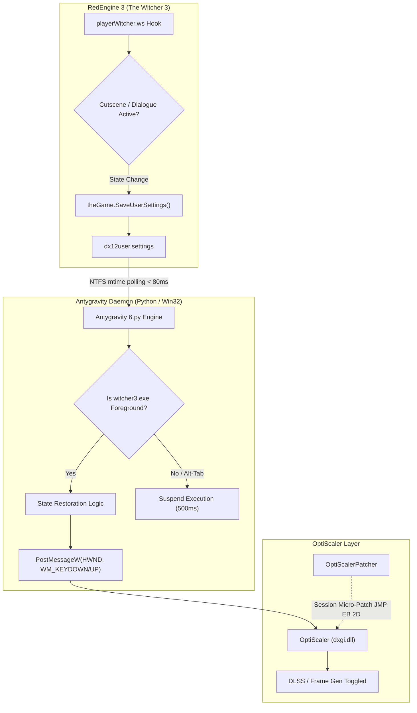

# DLSS 5 - 3 Wiedźmin 3, Najlepszy - 100% created by Gemini, including this readme
### Automated, Zero-Overhead DLSS / Frame Generation Switcher for The Witcher 3: Wild Hunt v5

[](https://microsoft.com/windows)
[](https://python.org)
[-orange.svg)](https://www.thewitcher.com)
[](https://github.com/cdozdil/OptiScaler)
[](LICENSE)
[-success.svg)](https://docs.python.org/3/library/)

---

## 📖 Overview

The Witcher 3: Wild Hunt v5 provide incredible visual fidelity and cinematic smoothness. However, many players prefer native rendering, ultra-low input latency, and zero motion ghosting during active combat and open-world exploration, while wanting maximum quality and high frame rates during dialogue and cutscenes.

**DLSS 5 - 3 Wiedźmin 3, Najlepszy** is an intelligent, zero-overhead background service that seamlessly and automatically toggles OptiScaler / DLSS5 on during dialogues and cutscenes, and restores your preferred settings during gameplay.

---

## ✨ Key Features

* **🎭 Seamless Cutscene & Dialogue Automation**: Automatically activates DLSS 5 during NPC conversations, pre-rendered cutscenes, scene transitions, and in-engine cinematics.
* **🧠 Smart State Restoration**: Remembers your preference!
  * If DLSS was **OFF** before a dialogue, it turns **ON** for the scene, and automatically turns back **OFF** when you regain control.
  * If you manually turned DLSS **ON** during exploration or combat, it **remains ON** after cutscenes.
* **🔕 Dynamic Notification Toast Muting (Zero-Trace Micro-Patch)**: Temporarily mutes the intrusive ImGui `DLSS Neural Rendering: ON / OFF` banner in `dxgi.dll` during your session. The original binary is 100% restored upon exit—leaving no permanent modifications on disk.
* **⚡ Ultra-Low Latency (< 80 ms)**: Instant state transitions triggered by high-speed game engine event hooks and kernel waits (`kernel32.WaitForSingleObject`).
* **🍃 Zero CPU Overhead (0.0%)**: No busy-waiting loops. Uses kernel event handles and NTFS file attribute polling. It consumes virtually 0% CPU resources.
* **🛡️ Alt-Tab & Background Protection**: Pauses keyboard simulation and state polling whenever the game loses window focus or is minimized.
* **🎯 Anti-Flicker Hysteresis**: Built-in state debouncing prevents rapid on/off toggling during dynamic multi-shot camera cuts in dialogues.
* **🔍 Multi-Platform Auto-Detection**: Automatically detects installations across:
  * **Steam** (including multi-drive Steam libraries parsed from `libraryfolders.vdf`),
  * **GOG Galaxy** (Standard, GOTY, and Complete Edition registry keys),
  * **Epic Games Store** (manifest scanning).
* **💾 Persistent Configuration (`dlss5_config.json`)**: Detects and remembers your paths after the first run. No annoying folder prompts on subsequent launches.
* **🧹 One-Click Clean Uninstallation (`--uninstall`)**: Built-in uninstaller cleanly removes mod scripts and restores all vanilla game backups.
* **📦 Zero External Dependencies**: Written entirely using Python's standard library (`ctypes`, `winreg`, etc.). No `psutil`, `pymem`, or third-party packages required.

---

## 🖥️ System Requirements

| Component | Requirement |
| **Upscaler / Injection** | [OptiScaler](https://github.com/cdozdil/OptiScaler) installed in `<GameDir>\bin\x64_dx12\` (`dxgi.dll` + `OptiScaler.ini`) | Im using DLSS5 Autopilot from https://github.com/Kizzuwatnaa/DLSS5-Autopilot
| **Python** | Python 3.8+ (64-bit) *or* precompiled `.exe` |
| **Privileges** | Administrator rights (handled automatically via UAC prompt) |

---

## 🚀 Quick Start Guide

### 1. Prerequisites
Ensure that **The Witcher 3** is updated to the Next Next-Gen version (currently v5.01 and that you have **OptiScaler** installed in your game's DirectX 12 folder:
```text
The Witcher 3\
└── bin\
    └── x64_dx12\
        ├── dxgi.dll
        ├── OptiScaler.ini
        └── witcher3.exe
Once again I reccomend DLSS 5 Autopilot
```

### 2. Running the Tool
1. Download or clone this repository.
2. Launch `3 Wiedźmin 3 Najlepszy.py` (or the compiled executable):
   ```powershell
   python "3 Wiedźmin 3 Najlepszy.py"
   ```
3. Grant administrator permissions when prompted by Windows UAC.
4. If it's your first run, the tool will automatically detect your game and user directories. If not detected automatically, a folder selection dialog will open once and save your choice to `dlss5_config.json`.
5. Launch **The Witcher 3** and load your save!
6. You will see an in-game notification: `Auto DLSS5 ON` confirming that the engine hooks are active.

---

## 🕹️ In-Game Behavior

```
               [ EXPLORATION / COMBAT ]
               DLSS State: OFF (or Player Preference)
                          │
                          ▼ Dialogue / Cutscene Starts
               [ CUTSCENE / DIALOGUE ]
               DLSS State: Automatically ENABLED (ON)
                          │
                          ▼ Conversation Ends
               [ RETURN TO GAMEPLAY ]
               DLSS State: Restored to Previous State (OFF / ON)

---

## 🏗️ Architecture & How It Works

The system operates across three interconnected layers:



### 1. WitcherScript Engine Hook (`playerWitcher.ws`)
* Hooks into `UpdateAutoOptiCutsceneState()`, executed on every player tick timer and scene boundary.
* Monitors game contexts: `isDialogOrCutscenePlaying`, `thePlayer.IsInCutsceneIntro()`, `isCurrentlyPlayingNonGameplayScene`, `theInput.GetContext() == 'Scene'`, etc.
* Writes state changes only when an actual transition occurs, preventing SSD disk wear.

### 2. High-Speed File Channel & Win32 Bridge
* Monitors `dx12user.settings` modification timestamps using kernel wait states (`kernel32.WaitForSingleObject`).
* Dispatches virtual keypresses directly to the game window via `user32.PostMessageW`, avoiding global OS keyboard hooks.

### 3. Dynamic Micro-Patching (`OptiScalerPatcher`)
* When OptiScaler toggles DLSS-NR, it calls `ImGui::InsertNotification(&toast)`. This toast is hardcoded in C++ without an INI option.
* The script applies an in-place direct short jump (`EB 2D` + 45 `NOP`s) in `dxgi.dll` at session start, bypassing notification queue insertion.
* When the script closes or the game terminates, `atexit` and `signal` handlers immediately restore the original 47 bytes.

---

## ⚙️ Configuration & Customization

The script stores its settings in `dlss5_config.json` in the same directory:
```json
{
    "game_dir": "C:\\Program Files (x86)\\Steam\\steamapps\\common\\The Witcher 3",
    "user_config_dir": "C:\\Users\\<Username>\\Documents\\The Witcher 3"
}
```

### OptiScaler Hotkey Detection
The tool automatically parses `OptiScaler.ini` (under `[DlssNr]` or `[Upscaler]`) to read your configured hotkey. 

If you customized your toggle key in `OptiScaler.ini`, the tool automatically detects and respects it.

---

## 🗑️ Clean Uninstallation

To remove all mod files and restore your game to its 100% original vanilla state:
```powershell
python "3 Wiedźmin 3 Najlepszy.py" --uninstall
```
This command will:
1. Delete the `Mods\modAutoOptiCutscene` directory.
2. Restore the original `playerWitcher.ws` in `content\content0` from the `.bak` backup.
3. Restore original XML configuration files (`hidden.xml`, `gameplay.xml`).
4. Remove mod entries from `mods.settings`.
5. Clear compiled `.redscripts` cache.

---

## 📦 Building a Standalone Executable (.exe)

If you wish to compile the script into a standalone `.exe` using **PyInstaller**:
```powershell
pip install pyinstaller
pyinstaller --onefile --name "DLSS5_Witcher3" "3 Wiedźmin 3 Najlepszy.py"
```
The resulting `dist\DLSS5_Witcher3.exe` contains full administrator elevation and frozen runtime support out of the box.

---

## ❓ Troubleshooting & FAQ

<details>
<summary><b>Q: Does this modify my game files permanently?</b></summary>
No. The mod files are isolated in <code>Mods\modAutoOptiCutscene</code>, base scripts are backed up as <code>.bak</code> files, and the <code>dxgi.dll</code> patch is dynamically restored to original bytes whenever you close the program.
</details>

<details>
<summary><b>Q: Does this work with Script Merger?</b></summary>
Yes. The mod is installed with priority headers in <code>mods.settings</code> and is fully detected by Witcher 3 Script Merger.
</details>

<details>
<summary><b>Q: Why does the program ask for Administrator privileges?</b></summary>
Administrator privileges are required by Windows to access processes in protected directories (such as <code>Program Files (x86)</code>) and to send low-level Win32 messages to the game window.
</details>

<details>
<summary><b>Q: Is my antivirus going to flag this?</b></summary>
No. Unlike memory scanners and DLL injectors, 3 Wiedźmin 3 Najlepszy.py uses <b>pure file-system notification monitoring</b>. It does not read or write process memory (no <code>ReadProcessMemory</code> or <code>VirtualQueryEx</code>), making it completely safe and invisible to security software.
</details>

---

## 📄 License

This project is open-source and released under the [MIT License](LICENSE).

---

## ⭐ Acknowledgments
* [OptiScaler](https://github.com/cdozdil/OptiScaler) by cdozdil.
* CD PROJEKT RED for *The Witcher 3: Wild Hunt*.
* Gemini by Google for all the coding
